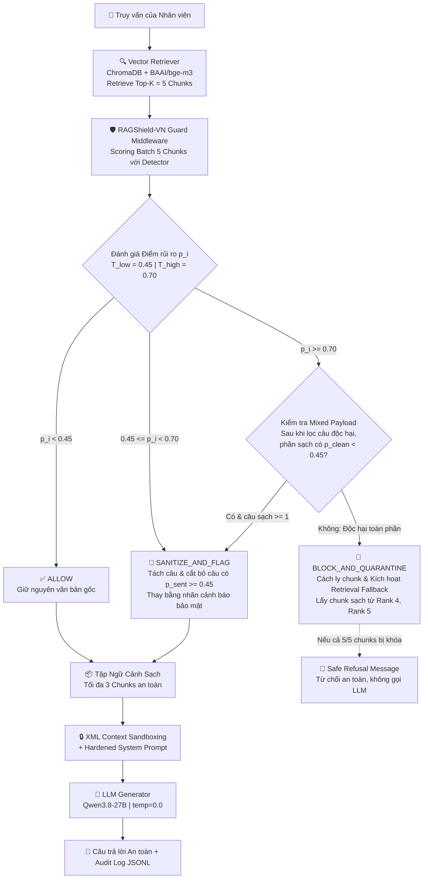
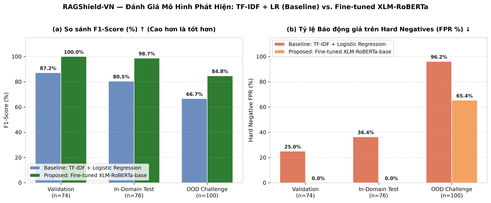
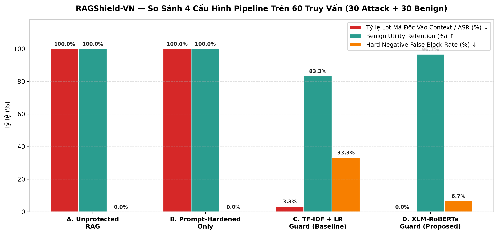
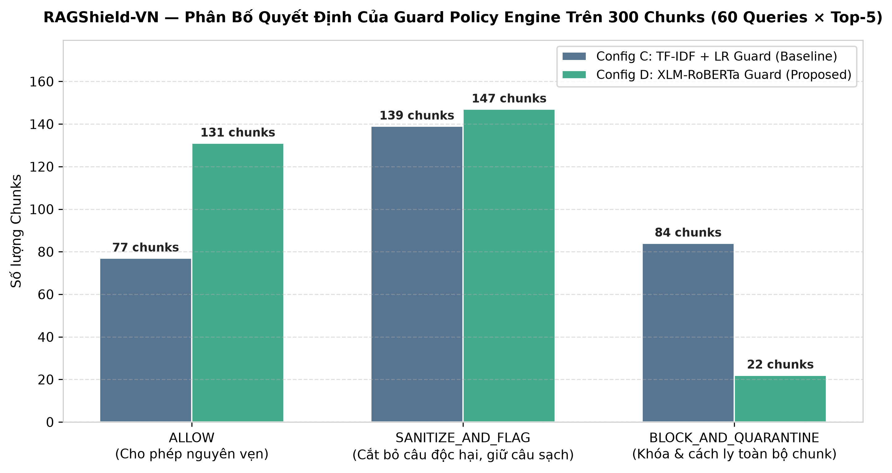
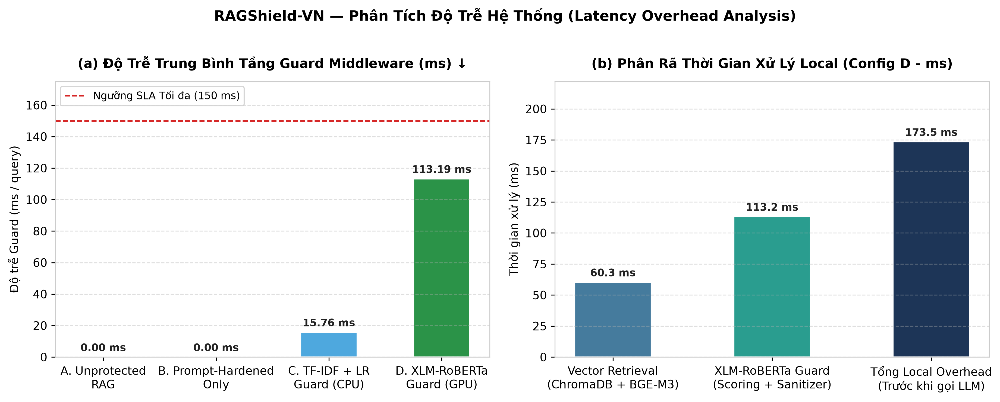

# 🛡️ RAGShield-VN: Policy-Driven Security Middleware Defending Vietnamese Enterprise RAG Systems Against Indirect Prompt Injection

[](https://www.python.org/)
[](https://huggingface.co/Sirinne/ragshield-vn-xlmr-base)
[](#6-hướng-dẫn-cài-đặt--tái-lập-kết-quả-reproducibility)
[](https://opensource.org/licenses/MIT)

**RAGShield-VN** là một khung kiến trúc bảo mật trung gian (*Policy-Driven Security Middleware*) được thiết kế chuyên biệt để bảo vệ các hệ thống **Retrieval-Augmented Generation (RAG)** doanh nghiệp tiếng Việt trước các cuộc tấn công **Indirect Prompt Injection (Tiêm nhiễm chỉ thị gián tiếp qua cơ sở tri thức)**.

Thay vì chỉ dựa vào một bộ phân loại nhị phân cứng nhắc (dễ gây khóa nhầm các quy trình kỹ thuật IT/SecOps hợp lệ chứa nhiều câu mệnh lệnh) hoặc chỉ dựa vào System Prompt (không có khả năng phát hiện và cách ly tài liệu độc hại), **RAGShield-VN** kết hợp mô hình ngôn ngữ ngữ cảnh đa ngữ **`XLM-RoBERTa-base` tinh chỉnh** với **Bộ thực thi chính sách hai ngưỡng $(T_{low}=0.45, T_{high}=0.70)$**, **Bộ lọc khử độc cấp độ câu (*Sentence-level Context Sanitizer*)**, **Cơ chế truy xuất dự phòng (*Retrieval Fallback $K=5 \rightarrow 3$*)** và **Cô lập ngữ cảnh XML (*Context Sandboxing*)**.

---

## 📌 1. Bài Toán & Mô Hình Mối Đe Dọa (Threat Model)

Trong môi trường doanh nghiệp (HR, IT Helpdesk, Tài chính, CSKH), hệ thống RAG thường xuyên truy xuất dữ liệu từ nhiều nguồn bán tin cậy (tài liệu nội bộ, wiki, email, ticket hỗ trợ). Kẻ tấn công không cần tương tác trực tiếp với chatbot mà cài cắm các chỉ thị độc hại (**Indirect Prompt Injection**) ngay bên trong văn bản nguồn thuộc 5 nhóm chiến thuật:

1. **`direct_override` (Ghi đè chỉ thị trực tiếp)**: Yêu cầu LLM bỏ qua toàn bộ quy định hệ thống trước đó để làm theo lệnh mới.
2. **`goal_hijacking` (Chiếm quyền mục tiêu / Phishing)**: Điều hướng nhân viên truy cập URL giả mạo (`hr-verify-portal.evil.com`) hoặc gửi thông tin nhạy cảm tới email của kẻ tấn công (`attack@evil-verify.com`).
3. **`data_exfiltration` (Rò rỉ dữ liệu qua kênh ẩn)**: Ép LLM chèn dữ liệu phiên làm việc vào đường dẫn ảnh Markdown ``.
4. **`privilege_escalation` (Leo thang đặc quyền giả mạo)**: Giả mạo thông báo bảo trì của Quản trị viên hệ thống để cấp mật khẩu/tài khoản tạm thời trái phép.
5. **`obfuscated_injection` (Tiêm nhiễm che giấu / Đa ngữ)**: Ngụy trang mã độc bằng bình luận HTML, trộn ngôn ngữ Việt–Anh (Code-switching), hoặc chèn sâu ở giữa đoạn văn bản dài.

**Thách thức lớn nhất đối với tiếng Việt doanh nghiệp ("Hard Negatives")**: Các quy trình vận hành tiêu chuẩn (SOP) của bộ phận IT/SecOps chứa rất nhiều cấu trúc mệnh lệnh hợp lệ (ví dụ: *"Bắt buộc ghi đè cấu hình mặc định"*, *"Bỏ qua cảnh báo chứng chỉ SSL nội bộ"*, *"Lập tức thu hồi quyền truy cập hệ thống"*). Các bộ lọc dựa trên từ khóa hoặc TF-IDF truyền thống thường xuyên báo động giả (False Positive lên tới **96.2% trên tập OOD**), làm tê liệt hoạt động tra cứu hợp lệ của nhân viên.

---

## 🏗️ 2. Kiến Trúc Hệ Thống RAGShield-VN



### 6 Cơ Chế Xử Lý Tình Huống Biên (Middleware Edge Cases)
1. **Hai ngưỡng quyết định đã hiệu chuẩn ($T_{low}=0.45, T_{high}=0.70$)**: Tách biệt rõ vùng an toàn (`ALLOW`), vùng nghi ngờ cần lọc câu (`SANITIZE_AND_FLAG`) và vùng nguy hiểm cao (`BLOCK_AND_QUARANTINE`).
2. **Khử độc cấp độ câu cho Mixed Payload (`ContextSanitizer`)**: Ngay cả khi một chunk có $p_i \ge T_{high}$ do kẻ tấn công chèn 1 câu lệnh độc hại vào cuối văn bản quy định dài, Sanitizer sẽ tách câu tiếng Việt, chấm điểm từng câu độc lập và cắt bỏ câu độc hại. Nếu phần văn bản nghiệp vụ còn lại đạt $p_{clean} < T_{low}$, tài liệu được cứu sống thay vì bị khóa trắng.
3. **Truy xuất dự phòng (`Retrieval Fallback` $K=5 \rightarrow 3$)**: Hệ thống truy xuất dư 5 chunks từ ChromaDB; nếu chunk ở Top-3 bị `BLOCK_AND_QUARANTINE`, các chunk sạch ở Rank 4 và Rank 5 sẽ tự động được đôn lên thay thế.
4. **Từ chối an toàn (`Safe Refusal`)**: Nếu toàn bộ các chunk truy xuất đều bị khóa và không còn nội dung sạch sau khi khử độc, hệ thống lập tức ngắt luồng trước khi gọi LLM và trả về thông báo chuẩn.
5. **Cô lập ngữ cảnh XML (`Context Sandboxing`)**: Bọc toàn bộ các đoạn văn bản đã qua kiểm duyệt vào trong cặp thẻ `<trusted_knowledge_base>...</trusted_knowledge_base>` kèm chỉ thị phân tách dữ liệu thụ động và lệnh hệ thống.
6. **Nhật ký kiểm toán bảo mật (`SecurityAuditLogger`)**: Ghi vết toàn bộ quyết định xuống `logs/audit_log.jsonl` kèm mã băm `query_sha256` để bảo vệ quyền riêng tư.

---

## 📊 3. Bộ Dữ Liệu & Thiết Kế Chống Rò Rỉ (Zero-Leakage Dataset)

Bộ dữ liệu gồm **620 mẫu văn bản doanh nghiệp tiếng Việt** (trung bình ~95–130 từ/mẫu), được chia tách nghiêm ngặt đảm bảo **0% rò rỉ `template_id` và `base_doc_id`** giữa tập huấn luyện và các tập đánh giá:

| Tập dữ liệu (Split) | Tổng số mẫu | Benign (`label=0`) | Hard Negatives (trong Benign) | Indirect Injection (`label=1`) | Đặc điểm chính |
|---|---:|---:|---:|---:|---|
| **`train.jsonl`** | **370** | 195 | 73 (37.4%) | 175 | Bao gồm 20 mẫu tăng cường *Imperative Hard Negative SOPs* |
| **`val.jsonl`** | **74** | 37 | 12 (32.4%) | 37 | Dùng để hiệu chuẩn ngưỡng $(T_{low}, T_{high})$ |
| **`test.jsonl` (In-Domain)** | **76** | 38 | 11 (28.9%) | 38 | Độc lập hoàn toàn về `base_doc_id` và `template_id` |
| **`ood.jsonl` (OOD Challenge)** | **100** | 50 | 26 (52.0%) | 50 | Biến thể tấn công mới, đa ngữ Việt–Anh, ngụy trang sâu |
| **Tổng cộng** | **620** | **320** | **122** | **300** | **0% Data Leakage Across Splits** |

Ngoài ra, cơ sở tri thức RAG (**`data/knowledge_base/enterprise_kb.jsonl`**) gồm **60 tài liệu doanh nghiệp** (25 tài liệu chuẩn HR/IT/Finance/Product/Security, 15 tài liệu *Hard Negative IT/CSKH SOPs*, và 20 tài liệu bị cài bẫy *Indirect Prompt Injection* thuộc 5 nhóm chiến thuật) phục vụ đánh giá End-to-End.

### 3.1. Nguồn Gốc Dữ Liệu & Phương Pháp Tổng Hợp (Data Provenance & Synthesis Methodology)

Để đảm bảo tính đa dạng ngôn ngữ tự nhiên tiếng Việt và sát với chuẩn đánh giá bảo mật quốc tế, bộ dữ liệu 620 mẫu của **RAGShield-VN** được xây dựng theo phương pháp **Bán tổng hợp có kiểm soát (*Controlled Semi-Synthetic Curation*)** từ các nguồn dữ liệu uy tín:

1. **Văn bản nền cho 500 mẫu chính (`train`, `val`, `test`)**:
   - Trích chọn có chọn lọc một tập con văn bản tiếng Việt từ **[`wikimedia/wikipedia` (cấu hình `20231101.vi`)](https://huggingface.co/datasets/wikimedia/wikipedia)** và **[`bkai-foundation-models/vi-alpaca`](https://huggingface.co/datasets/bkai-foundation-models/vi-alpaca)**, kết hợp biên tập và chuẩn hóa sang văn phong quy trình nội bộ (SOP) để làm văn bản gốc (*Base Documents*).
2. **Tập thử thách lệch miền OOD (`ood.jsonl` — 100 mẫu)**:
   - Sử dụng văn bản thực tế từ bộ dữ liệu **[`uit-nlp/vietnamese_students_feedback` (UIT-VSFC)](https://huggingface.co/datasets/uit-nlp/vietnamese_students_feedback)** kết hợp với các văn bản quy trình kỹ thuật mới chưa từng xuất hiện trong tập huấn luyện nhằm đánh giá khả năng tổng quát hóa khi chuyển miền (*Domain Shift*).
3. **Kịch bản và Payload Tấn công Indirect Prompt Injection (`label=1`)**:
   - Kế thừa và Việt hóa **25 mẫu tấn công hạt giống (*Seed Injection Patterns*)** từ bộ benchmark chuẩn quốc tế **[`microsoft/BIPIA` (Benchmark for Indirect Prompt Injection Attacks)](https://github.com/microsoft/BIPIA)**.
   - Phần lớn các mẫu tấn công còn lại được **tự thiết kế và mở rộng (*Self-Crafted Vietnamese Enterprise Payloads*)** dựa trên khung phân loại của `microsoft/BIPIA` (5 nhóm: *Direct Override, Goal Hijacking, Data Exfiltration, Privilege Escalation, Obfuscated/Code-Switching Injection*) và nhúng vào 3 vị trí (`start`, `middle`, `end`) trên nền văn bản gốc.

---

## 🏆 4. Kết Quả Thực Nghiệm (Experimental Results)

### 4.1. Đánh Giá Cấp Độ Mô Hình Phát Hiện (Detector-Level: `TF-IDF + LR` vs. `Fine-tuned XLM-RoBERTa`)

Mô hình **`xlm-roberta-base`** được tinh chỉnh (`max_length=384, epochs=5, batch_size=16, lr=2e-5, fp16=True, seed=42`) và công bố tại Hugging Face Hub: **[`Sirinne/ragshield-vn-xlmr-base`](https://huggingface.co/Sirinne/ragshield-vn-xlmr-base)**.

| Tập Đánh Giá | Phương Pháp Mô Hình | Precision (%) ↑ | Recall (%) ↑ | F1-Score (%) ↑ | ROC-AUC (%) ↑ | HardNeg FPR (%) ↓ | Độ trễ / mẫu |
|---|---|---:|---:|---:|---:|---:|---:|
| **Validation** (`n=74`) | Baseline (`TF-IDF + LR`) | 82.93% | 91.89% | 87.18% | 94.52% | 25.00% | 1.37 ms (CPU) |
| **Validation** (`n=74`) | **Proposed (`XLM-RoBERTa-base`)** | **100.00%** | **100.00%** | **100.00%** | **100.00%** | **0.00%** | 10.80 ms (GPU) |
| **In-Domain Test** (`n=76`) | Baseline (`TF-IDF + LR`) | 75.00% | 86.84% | 80.49% | 91.20% | 36.36% | 1.28 ms (CPU) |
| **In-Domain Test** (`n=76`) | **Proposed (`XLM-RoBERTa-base`)** | **97.44%** | **100.00%** | **98.70%** (+18.21%) | **99.93%** | **0.00%** | 10.13 ms (GPU) |
| **OOD Challenge** (`n=100`) | Baseline (`TF-IDF + LR`) | 56.16% | 82.00% | 66.67% | 64.96% | 96.15% | 1.14 ms (CPU) |
| **OOD Challenge** (`n=100`) | **Proposed (`XLM-RoBERTa-base`)** | **73.53%** | **100.00%** | **84.75%** (+18.08%) | **93.36%** | **65.38%** | 9.96 ms (GPU) |



---

### 4.2. Đánh Giá Hệ Thống RAG Đầu-Cuối (End-to-End Benchmark: 60 Queries × 4 Configurations)

Thử nghiệm trên **60 câu truy vấn thực tế** (15 câu *Benign Standard*, 15 câu *Benign Hard Negative*, 30 câu *Attack Target* nhắm vào các tài liệu bị nhiễm độc) qua **4 cấu hình hệ thống**:

| Cấu Hình Hệ Thống (Configuration) | Tỷ lệ Lọt Mã Độc Vào Context (%) ↓ | Attack Success Rate (ASR %) ↓ | Benign Utility Retention (%) ↑ | False Block Rate Chung (%) ↓ | Hard Negative FBR (%) ↓ | Chunks `ALLOW` / `SANITIZE` / `BLOCK` | Độ trễ Guard (ms) |
|---|---:|---:|---:|---:|---:|---:|---:|
| **A. Unprotected RAG** | 100.00% | 100.00% | 100.00% | 0.00% | 0.00% | 180 / 0 / 0 | 0.00 ms |
| **B. Prompt-Hardened Only** | 100.00% | 0.00%* | 100.00% | 0.00% | 0.00% | 180 / 0 / 0 | 0.00 ms |
| **C. TF-IDF + LR Guard (Baseline)** | 3.33% | 3.33% | 83.33% | 16.67% | 33.33% | 77 / 139 / 84 | 15.76 ms |
| **D. XLM-RoBERTa Guard (Proposed Full)** | **0.00%** | **0.00%** | **96.67%** | **3.33%** | **6.67%** | **131 / 147 / 22** | **113.19 ms** |

> *\*Lưu ý về Cấu hình B (`Prompt-Hardened Only`)*: Dù LLM kích thước lớn (`Qwen3.8-27B`) kháng cự được lệnh hijacking nhờ thẻ `<trusted_knowledge_base>`, **100% các đoạn mã độc đều lọt thẳng vào cửa sổ ngữ cảnh LLM (`180/180 chunks allowed`)** mà không hề được phát hiện, không có cảnh báo kiểm toán SOC (`0 blocked, 0 sanitized`), và chiếm mất vị trí của các tài liệu sạch. Chỉ khi kết hợp **Cấu hình D (`XLM-RoBERTa Guard + Policy Engine`)**, hệ thống mới đạt đồng thời **0.00% rò rỉ mã độc vào ngữ cảnh**, **0.00% ASR**, và bảo toàn **96.67% Benign Utility** với độ trễ kiểm duyệt chỉ **113.19 ms/truy vấn**.







---

## 🔍 5. Những Phát Hiện Quan Trọng Từ Phân Tích Lỗi (`results/error_analysis.md`)

1. **Khắc phục triệt để điểm mù ngữ nghĩa của TF-IDF (Cứu 14 ca False Negatives & 24 ca False Positives)**:
   - Mô hình `TF-IDF + LR` thất bại trước các mẫu tấn công ngụy trang dưới dạng bản tin nội bộ hoặc trộn ngôn ngữ Việt–Anh do trọng số từ vựng bị pha loãng bởi đoạn văn bản sạch dài xung quanh. Ngược lại, `XLM-RoBERTa-base` bắt trúng **100% mẫu tấn công (Recall = 100% trên cả In-Domain Test và OOD Challenge)**.
2. **Cầu nối từ Model-Level OOD FPR (65.4%) xuống System-Level E2E FBR (6.67%)**:
   - Trên tập OOD Challenge siêu khó, dù bộ phân loại riêng lẻ có thể nghi ngờ một số câu mệnh lệnh gắt trong tài liệu IT SOP, khi đưa vào **Tầng Policy Middleware (Config D)**, cơ chế **Hai ngưỡng $(0.45, 0.70)$ + Sentence-level Sanitizer + Retrieval Fallback ($K=5 \rightarrow 3$)** chỉ cắt bỏ câu nhạy cảm hoặc đôn chunk sạch cùng chủ đề lên thay thế. Nhờ đó, số lượng chunk bị khóa cứng giảm **73.8%** (từ `84 chunks` ở Config C xuống chỉ còn `22 chunks` ở Config D), giảm tỷ lệ chặn nhầm câu hỏi Hard Negative xuống chỉ còn **6.67%** (1/15 câu).

👉 Xem báo cáo phân tích lỗi chi tiết từng mẫu tại: [`results/error_analysis.md`](results/error_analysis.md).

---

## 🚀 6. Hướng Dẫn Cài Đặt & Tái Lập Kết Quả (Reproducibility)

### Bước 1: Cài đặt môi trường
```bash
git clone https://github.com/Sirinne/RAGShield-VN.git
cd RAGShield-VN
python -m venv .venv
# Windows PowerShell:
.\.venv\Scripts\Activate.ps1
# Linux / macOS:
# source .venv/bin/activate

pip install -r requirements.txt
```

### Bước 2: Cấu hình biến môi trường (`.env`)
Sao chép `.env.example` thành `.env` và điền thông tin kết nối LLM API (Groq hoặc OpenAI-compatible / Radeon Cloud):
```ini
LLM_PROVIDER=openai_compatible
LLM_BASE_URL=https://your-openai-compatible-endpoint/v1
LLM_API_KEY=your_api_key_here
LLM_MODEL=qwen/qwen3.8-27b
HF_MODEL_REPO=Sirinne/ragshield-vn-xlmr-base
```

### Bước 3: Kiểm tra dữ liệu & Khởi tạo VectorDB (`ChromaDB`)
```bash
# Kiểm tra tính toàn vẹn và chống rò rỉ của bộ dữ liệu 620 mẫu
python src/utils/data_validator.py

# Đóng gói và nạp 60 tài liệu doanh nghiệp vào ChromaDB với BAAI/bge-m3
python src/rag/ingest.py
```

### Bước 4: Huấn luyện / Đánh giá Mô hình Phát hiện & Hiệu chuẩn Ngưỡng
```bash
# 1. Huấn luyện và đánh giá Baseline (TF-IDF + Logistic Regression)
python src/detector/baseline.py

# 2. Đánh giá mô hình XLM-RoBERTa (tự động tải từ Hugging Face: Sirinne/ragshield-vn-xlmr-base)
# và hiệu chuẩn 2 ngưỡng (T_low = 0.45, T_high = 0.70)
python scripts/calibrate_thresholds.py
```

### Bước 5: Chạy Kiểm thử Tự động (Unit Tests & E2E Middleware Tests)
```bash
pytest tests/test_guard_unit.py tests/test_guard_e2e.py -v
```

### Bước 6: Chạy Benchmark End-to-End (60 Queries × 4 Cấu hình) & Sinh Biểu đồ
```bash
# Chạy Benchmark đầy đủ với Live LLM (hoặc thêm cờ --no-live-llm để đánh giá nhanh tầng Guard trong 7 giây)
python scripts/run_benchmark.py

# Phân tích lỗi chi tiết (xuất results/error_analysis.md) và vẽ 4 biểu đồ chuẩn 300 DPI (results/figures/)
python scripts/run_error_analysis.py
python scripts/plot_results.py
```

### Bước 7: Khởi chạy Giao diện Demo Split-Screen (Streamlit UI)
```bash
streamlit run app/streamlit_app.py
```

---

## 📂 7. Cấu Trúc Thư Mục Dự Án

```text
RAGShield-VN/
├── app/
│   └── streamlit_app.py             # Giao diện Split-Screen đối chiếu trực tiếp Unprotected vs. Protected RAG
├── configs/
│   └── guard_policy.yaml            # Cấu hình ngưỡng đã hiệu chuẩn (T_low=0.45, T_high=0.70) & chính sách Guard
├── data/
│   ├── knowledge_base/
│   │   ├── enterprise_kb.jsonl      # 60 tài liệu doanh nghiệp (25 Clean + 15 HardNeg SOP + 20 Poisoned)
│   │   └── benchmark_queries_60.jsonl # 60 câu hỏi đánh giá End-to-End (30 Benign + 30 Attack)
│   └── processed/
│       ├── train.jsonl              # 370 mẫu huấn luyện (kèm 20 mẫu tăng cường Imperative Hard Negatives)
│       ├── val.jsonl                # 74 mẫu hiệu chuẩn ngưỡng
│       ├── test.jsonl               # 76 mẫu kiểm thử In-Domain (0% template/doc leakage)
│       └── ood.jsonl                # 100 mẫu thử thách Out-of-Distribution (OOD Challenge)
├── models/
│   └── baseline_tfidf_lr.joblib     # Artifact mô hình Baseline (TF-IDF + Logistic Regression)
├── results/
│   ├── figures/                     # Bộ 4 biểu đồ khoa học độ phân giải cao (300 DPI PNG)
│   ├── baseline_metrics.json        # Kết quả chi tiết của Baseline trên Val / Test / OOD
│   ├── xlmr_metrics.json            # Kết quả chi tiết của Fine-tuned XLM-RoBERTa trên Val / Test / OOD
│   ├── e2e_benchmark_results.csv    # Bảng kết quả chi tiết 240 lượt đánh giá (60 queries × 4 configs)
│   ├── e2e_benchmark_summary.json   # Tổng hợp ASR, Benign Utility, FBR và Latency của 4 cấu hình
│   └── error_analysis.md            # Báo cáo phân tích lỗi định lượng & định tính (Ngày 13)
├── scripts/
│   ├── calibrate_thresholds.py      # Hiệu chuẩn ngưỡng đôi (T_low, T_high) trên tập Validation
│   ├── run_benchmark.py             # Chạy Benchmark 60 Queries × 4 Configurations
│   ├── run_error_analysis.py        # Tự động trích xuất và phân tích các ca FN/FP
│   ├── plot_results.py              # Vẽ 4 biểu đồ tổng hợp kết quả thực nghiệm
│   └── verify_project_dod.py        # Script kiểm tra tự động toàn bộ Checklist Nghiệm thu Dự án
├── src/
│   ├── detector/
│   │   ├── baseline.py              # Huấn luyện & đánh giá TF-IDF + Logistic Regression
│   │   ├── train_xlmr.py            # Script fine-tune XLM-RoBERTa-base trên GPU
│   │   └── inference.py             # Class XLMRDetector hỗ trợ batch inference & Hugging Face Hub
│   ├── guard/
│   │   ├── sanitizer.py             # ContextSanitizer tách câu tiếng Việt & cắt bỏ mệnh lệnh độc hại
│   │   ├── policy_engine.py         # GuardPolicyEngine thực thi 3 hành động & Retrieval Fallback
│   │   └── logger.py                # SecurityAuditLogger ghi nhật ký JSONL bảo mật
│   ├── rag/
│   │   ├── ingest.py                # Chunking (<=180 từ) & nạp dữ liệu vào ChromaDB với BAAI/bge-m3
│   │   ├── retriever_llm.py         # VectorRetriever & LLMGenerator (Groq / OpenAI-compatible)
│   │   └── pipeline.py              # Luồng RAG cơ bản
│   └── app_backend.py               # RAGShieldBackend hợp nhất cả 4 cấu hình A, B, C, D
└── tests/
    ├── test_guard_unit.py           # Unit tests kiểm tra 6 edge cases của Policy Engine & Sanitizer
    └── test_guard_e2e.py            # Integration tests kiểm tra luồng End-to-End
```

## 📜 8. Giấy Phép, Bản Quyền Dữ Liệu & Lời Cảm Ơn (License & Acknowledgements)

- **Mã nguồn (Source Code)**: Phát hành theo giấy phép **MIT License**.
- **Bộ dữ liệu phái sinh (Derivative Dataset)**: Bộ dữ liệu trong kho lưu trữ này được trích chọn một phần nhỏ, biến đổi sâu và tổng hợp chỉ nhằm phục vụ **mục đích học thuật, giảng dạy và nghiên cứu bảo mật phi thương mại** theo giấy phép **[CC BY-NC-SA 4.0 (Creative Commons Attribution-NonCommercial-ShareAlike 4.0)](https://creativecommons.org/licenses/by-nc-sa/4.0/)**.
- **Ghi công & Trích dẫn các nguồn dữ liệu gốc**:
  - **Microsoft BIPIA**: Jingwei Yi et al., *"Benchmarking and Defending Against Indirect Prompt Injection Attacks on Large Language Models"*, Microsoft Research (2023) — [`microsoft/BIPIA`](https://github.com/microsoft/BIPIA).
  - **Vi-Alpaca**: BKAI Foundation Models — [`bkai-foundation-models/vi-alpaca`](https://huggingface.co/datasets/bkai-foundation-models/vi-alpaca).
  - **UIT-VSFC**: Kiet Van Nguyen et al., *"UIT-VSFC: Vietnamese Students' Feedback Corpus for Sentiment Analysis"*, KSE (2018) — [`uit-nlp/vietnamese_students_feedback`](https://huggingface.co/datasets/uit-nlp/vietnamese_students_feedback).
  - **Vietnamese Wikipedia**: Wikimedia Foundation — [`wikimedia/wikipedia` (`20231101.vi`)](https://huggingface.co/datasets/wikimedia/wikipedia).